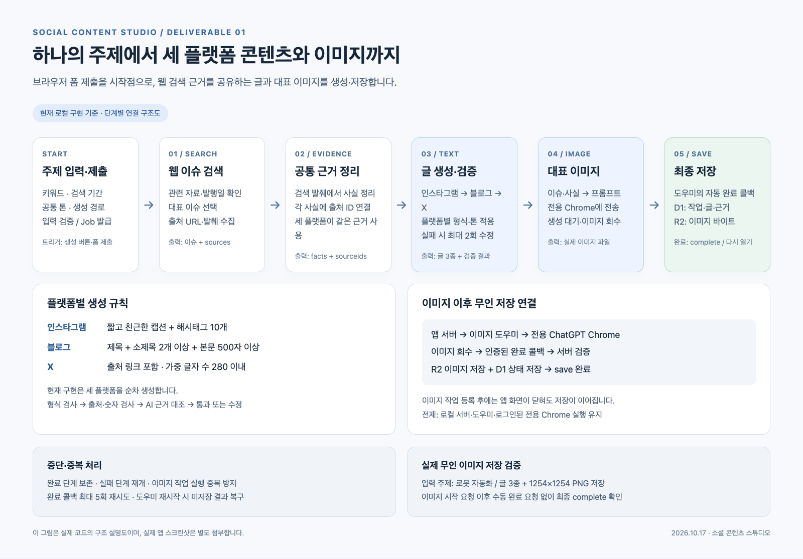
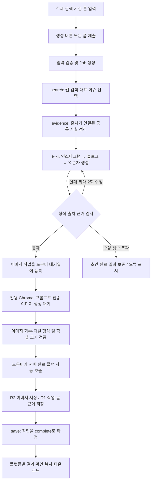
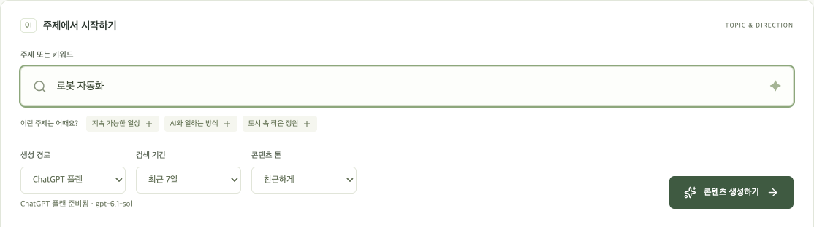
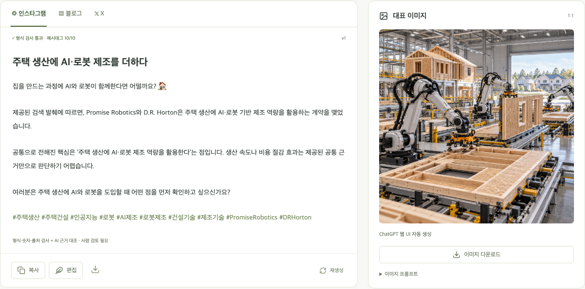
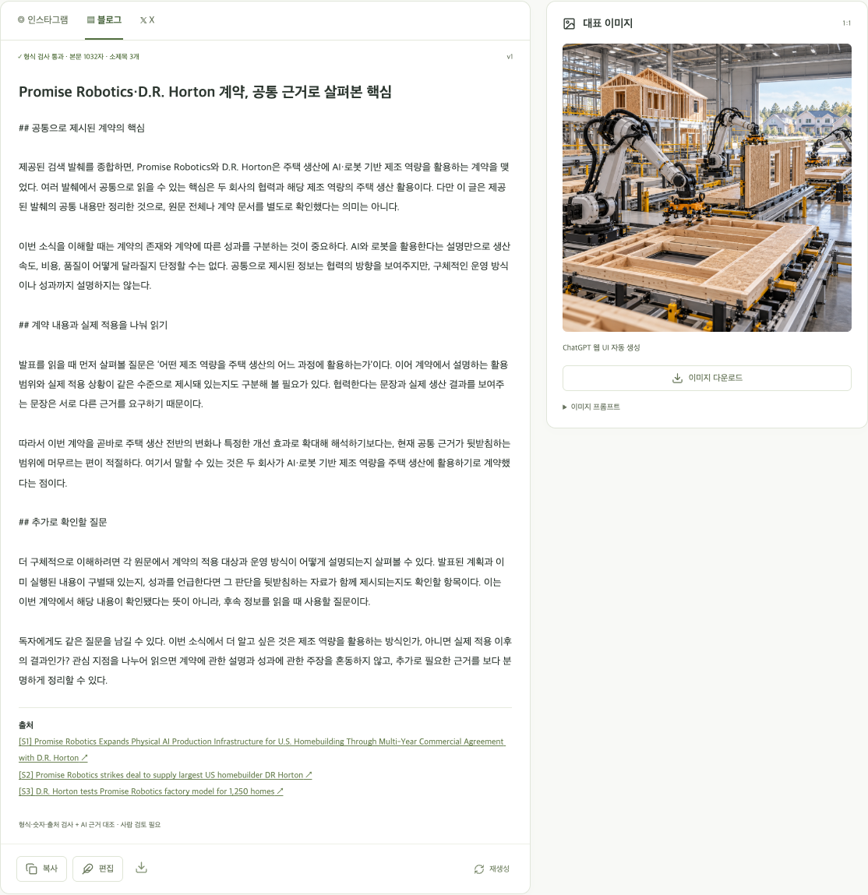
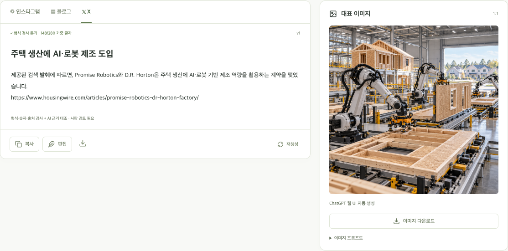

# 1. 자동화 워크플로우

**프로젝트명:** 소셜 콘텐츠 스튜디오  
**산출물:** 워크플로우 구조 스크린샷 및 단계별 역할·연결 설명서  
**작성 기준:** 2026년 10월 17일 로컬 구현 및 실행 검증 결과

## 1. 구현 목적

하나의 주제나 키워드로 인스타그램, 블로그, X용 콘텐츠와 대표 이미지를 생성하고 한 작업 기록으로 저장하는 브라우저 기반 자동화 시스템이다. 같은 내용을 플랫폼별로 반복 작성하는 시간을 줄여 기획과 검토에 집중하도록 한다.

사용자는 주제, 검색 기간, 톤을 설정한 뒤 생성 버튼을 한 번 누른다. 이후 최신 이슈 검색, 공통 근거 정리, 플랫폼별 글 생성·검증, 대표 이미지 생성, 결과 저장이 연결된다. 현재 사용하는 경로는 **ChatGPT 계정 연결을 통한 검색·글 생성과 별도 로그인된 전용 Chrome을 통한 이미지 생성**이다.

## 2. 워크플로우 구조 스크린샷

*그림 1. 현재 코드의 연결 관계를 도식화한 화면을 브라우저에서 캡처했다. 노드 편집형 자동화 도구의 화면이 아니라 직접 구현한 웹앱의 구조 설명도이다. 편집 가능한 원본은 `assets/workflow-structure.html`이다.*

### 텍스트 구조도

세 플랫폼은 같은 공통 사실을 참조한다. 한 플랫폼의 글을 다음 플랫폼이 다시 요약하는 구조가 아니므로, 변환 과정에서 사실이 누적해서 달라지는 것을 줄인다. 현재 코드는 인스타그램, 블로그, X 순으로 생성·검증하며 병렬 실행하지 않는다.

## 3. 실제 앱 스크린샷

### 입력 폼

*그림 2. 실제 앱의 입력 폼. 주제 입력 예시는 ‘로봇 자동화’이며, 이 캡처에서는 새 생성을 실행하지 않았다.*

### 단계 진행 상태

*그림 3. 저장된 실제 작업의 검색 → 근거 정리 → 글 생성 → 이미지 → 저장 단계 완료 표시.*

### 플랫폼별 생성 결과와 대표 이미지

*그림 4. 인스타그램 결과 탭과 실제 생성·저장된 대표 이미지.*

*그림 5. 블로그 결과 탭. 제목·소제목·본문·출처를 확인할 수 있다.*

*그림 6. X 결과 탭. 화면에서 가중 글자 수 검증 결과를 확인할 수 있다.*

## 4. 입력과 자동 실행 조건

| 항목 | 설정 및 동작 |
| --- | --- |
| 주제 또는 키워드 | 2~120자. 예: 로봇 자동화 |
| 검색 기간 | 최근 24시간, 7일, 30일 중 선택 |
| 공통 톤 | 친근하게, 전문적으로, 간결하게 중 선택 |
| 생성 경로 | 현재 시연은 ChatGPT 계정 연결 경로 사용 |
| 이미지 경로 | ChatGPT 웹 UI 자동 생성 선택 |
| 트리거 | 생성 버튼 클릭 또는 폼 제출. 입력값을 타이핑하는 순간이 아니라 제출 시 자동화 시작 |
| 실행 전 준비 | 로컬 앱 서버, 계정 연결 도우미, 이미지 도우미 실행 및 전용 Chrome의 ChatGPT 로그인 유지 |

연결과 로그인은 사전 준비 단계다. 준비된 상태에서는 작업마다 프롬프트를 옮기거나 생성 이미지를 직접 첨부할 필요가 없다.

## 5. 단계별 역할과 입출력

| 단계 | 입력 | 주요 역할 | 출력 및 다음 연결 |
| --- | --- | --- | --- |
| 입력·작업 생성 | 주제, 기간, 톤, 생성 경로 | 서버가 입력 형식을 검증하고 요청 ID로 중복 생성을 방지한다. 작업 ID를 발급한다. | 공통 작업 객체 `Job` → 검색 |
| ① 검색 `search` | 주제, 검색 시작·종료 시점 | 생성형 AI의 웹 검색 기능으로 관련 자료를 찾고 대표 이슈를 선택한다. 검색 도구가 반환한 URL인지 검사하고 중복 URL을 제거한다. | 이슈 제목, 출처 목록, URL, 발행일, 검색 발췌 → 근거 정리 |
| ② 근거 정리 `evidence` | 검색 단계의 출처·발췌 | 확보된 발췌에서 공통 사실을 정리한다. 각 사실에 `S1`, `S2` 등의 출처 ID를 연결하고 존재하지 않는 출처 참조를 차단한다. | 공통 사실 목록 `facts` → 세 플랫폼 글 생성 |
| ③ 글 생성·검증 `text` | 동일한 공통 사실, 출처, 공통 톤 | 플랫폼별 지시문으로 초안을 순차 생성한다. 글자 수·해시태그·소제목·출처·숫자를 검사하고 AI로 근거를 대조한다. 실패하면 플랫폼별로 최대 2회 수정한다. | 인스타그램·블로그·X 초안 및 검증 결과 → 이미지 생성 |
| ④ 이미지 `image` | 대표 이슈, 공통 사실, 추가 이미지 방향 | 이미지 프롬프트를 구성해 도우미에 전달한다. 전용 Chrome에서 입력 유지와 보내기 버튼 준비 상태를 확인한 뒤 전송하고, 생성 결과를 기다려 이미지를 회수한다. | 실제 이미지 파일과 프롬프트·생성 경로·크기 → 완료 콜백 |
| ⑤ 저장 `save` | 세 플랫폼 글, 출처·사실, 검증된 이미지 | 이미지 도우미의 완료 콜백을 인증하고 작업 귀속을 확인한다. 실제 이미지 바이트는 R2, 작업 데이터는 D1에 저장한 뒤 완료 상태를 확정한다. | `status=complete` → 결과 화면·기록·다운로드 |

검색 기간 내 발행일이 확인된 자료가 하나도 없으면 검색을 중단하고 기간이나 주제를 조정하도록 안내한다. 자료의 발행일을 확인하지 못한 경우에는 미확인으로 남긴다.

## 6. 플랫폼별 콘텐츠 생성 규칙

| 플랫폼 | 형식 | 톤 조정 | 자동 검사 |
| --- | --- | --- | --- |
| 인스타그램 | 짧은 도입·캡션과 해시태그 10개 | 친근하고 읽기 쉬운 표현, 독자의 관심을 유도하는 도입 | 해시태그 정확히 10개, 출처 ID, 근거에 없는 숫자 여부 |
| 블로그 | 제목, 소제목 2개 이상, 본문 500자 이상 | 맥락과 의미를 설명하는 서술형 글. 선택한 공통 톤을 반영 | 제목 존재, `##` 소제목 수, 소제목·출처 목록을 제외한 본문 길이 |
| X | 핵심 요약과 출처 링크, 가중 길이 280 이내 | 짧고 핵심적인 문장 | `twitter-text`로 URL·한글 등을 반영한 가중 글자 수 및 유효성 검사 |

모든 플랫폼에서 공통 사실에 없는 숫자·날짜를 검사하고 허용된 출처 외의 링크를 차단한다. 형식 검사 통과가 사실의 완전한 정확성을 보장하지는 않으므로, 실제 게시 전 최종 검토는 필요하다.

## 7. 구성 요소와 연결 방식

| 구성 요소 | 역할 | 주요 구현 파일 |
| --- | --- | --- |
| 브라우저 웹앱 | 폼 입력, 단계별 API 호출, 진행·결과 표시 | `app/page.tsx` |
| 앱 서버 API | 입력 검증, 작업 조회·저장, 단계 실행, 이미지 완료 콜백 | `app/api/[...path]/route.ts` |
| 파이프라인 | 실행 순서 제어, 플랫폼별 생성·수정, 완료 상태 관리 | `lib/pipeline.ts` |
| 검색·텍스트 제공자 | 웹 검색, 사실 정리, 플랫폼별 작성과 근거 대조 | `lib/provider.ts` |
| 계정 연결 도우미 | ChatGPT 계정 인증과 서버 측 추론 연결 | `local/server.ts`, `local/plan-service.ts` |
| 이미지 도우미 | 대기열, 전용 Chrome 조작, 이미지 회수, 저장 콜백·재시도 | `local/web-image-server.ts` |
| 형식·파일 검증 | 플랫폼 규칙 및 이미지 바이트·크기 확인 | `lib/validation.ts`, `lib/image-upload.ts` |
| D1·R2 저장소 | 작업 JSON과 실제 이미지 파일 저장. 현재 로컬 에뮬레이션 사용 | `lib/storage.ts`, `.wrangler/state` |

### 주요 연결 순서

1. 브라우저가 `POST /api/jobs`로 작업을 만든다.
2. 브라우저가 `/api/jobs/:id/steps/search`, `/evidence`, `/text`를 자동으로 순차 호출한다.
3. 텍스트 생성이 끝나면 `POST /api/jobs/:id/image-task`를 호출한다.
4. 앱 서버가 로컬 이미지 도우미(4320번 포트)에 인증된 요청을 보낸다. 도우미는 전용 Chrome(9223번 포트)의 일반 ChatGPT 화면을 제어한다.
5. 이미지가 회수되면 도우미가 `POST /api/jobs/:id/image-task/:taskId/complete`를 자동 호출한다.
6. 서버는 도우미에서 완료 결과를 조회해 소유자·작업 ID를 검증하고, 이미지 저장과 `save` 단계를 처리한다.
7. 화면은 진행 결과를 조회한다. 최종 저장된 작업은 작업 기록이나 `?job=작업ID` 주소로 다시 열 수 있다.

공통 작업 ID가 검색 자료, 사실, 플랫폼별 글, 이미지 작업과 저장 파일을 연결한다. 예를 들어 이미지 저장 키는 `작업ID/cover-chatgpt-web.png` 형태다. 이미지의 임시 웹 주소만 저장하지 않고 실제 파일을 보관한다.

## 8. 자동화 유지와 오류 처리

- **입력·글 생성 구간:** 현재 브라우저가 단계별 호출을 연결하므로 이 구간에서는 앱 화면을 유지한다.
- **이미지 작업 등록 이후:** 이미지 도우미가 독립적으로 실행하고 완료 콜백으로 저장한다. 앱 화면을 닫아도 이 구간의 생성·저장은 이어지며, 로컬 서버·도우미·전용 Chrome은 계속 실행되어야 한다.
- **전송 대기:** 입력 내용이 유지되고 보내기 버튼이 활성화되는지 확인한 뒤 전송한다.
- **실패 재개:** 미전송 실패 작업은 다시 전송을 시도한다. 전송 기록이 있는 작업은 기존 생성 결과 회수를 재개한다.
- **중복 실행 방지:** 요청 ID, 이미지 작업 대기열의 실행 관리, 서버 작업 잠금과 완료 단계 확인으로 중복 처리를 줄인다.
- **저장 실패:** 이미지 도우미가 완료 콜백을 최대 5회 백오프로 재시도한다. 완료됐지만 앱에 저장되지 않은 작업은 도우미 재시작 시 저장을 재개한다.
- **일부 단계 실패:** 이미 생성한 글·근거를 보존하고 오류를 표시한다. 검증 실패나 로그인 만료 등으로 멈춘 경우에는 원인을 해결한 뒤 재시도한다.

## 9. 실제 실행 검증 결과

아래 수치는 저장된 실제 작업의 검증 결과다. 고정 데모 결과가 아니다.

| 확인 항목 | 결과 |
| --- | --- |
| 입력 주제 | 로봇 자동화 |
| 작업 ID | `e2c94f8f-978c-470e-a800-1852f6d3ddde` |
| 출처·공통 사실 | 출처 3개, 공통 사실 4개 |
| 인스타그램 | 캡션 본문 길이 257자, 해시태그 10개, 검증 통과 |
| 블로그 | 검증 기준 본문 길이 1,032자, 소제목 3개, 검증 통과 |
| X | 가중 길이 148/280, 검증 통과 |
| 대표 이미지 | PNG, 1254×1254 픽셀, ChatGPT 웹 UI 자동 생성 |
| 최종 상태 | `complete`, 완료 단계 `search / evidence / text / image / save` |
| 무인 저장 확인 | 이미지 작업 시작 요청 1회 후 수동 이미지 폴링·완료 요청 없이 도우미 콜백 1회로 최종 저장 완료 |

이 작업은 검색·근거·텍스트 단계의 API를 순서대로 실행한 뒤, 이미지 작업을 한 번 시작하고 이후에는 작업 상태만 조회하여 저장 완료를 확인했다. 따라서 이미지 이후 무인 저장 검증이며, 이 테스트를 폼 클릭부터 전체 과정을 한 번에 검증한 기록으로 표현하지 않는다. 별도의 기존 작업 `804c47fa-9d87-4f98-933e-3453bbc53a36`에서는 텍스트 재시도 후 브라우저 파이프라인이 이미지 회수·저장까지 추가 개입 없이 이어진 것을 확인했다.

로컬 결과 확인 주소: <http://127.0.0.1:5173/?job=e2c94f8f-978c-470e-a800-1852f6d3ddde>. 이 주소는 해당 Mac의 서버가 실행 중일 때만 열린다. 제출 시에는 아래 파일 묶음의 스크린샷을 사용한다.

## 10. 구현 범위와 제출 파일

현재 구현은 로컬 환경에서 사용하는 웹앱이다. 게시 가능한 초안과 대표 이미지의 생성·저장까지 처리하며, SNS 계정에 직접 게시하는 기능은 포함하지 않는다. ‘최근 화제’는 웹 검색 자료의 관련성·발행일·발행처를 활용해 선정한 대표 이슈이며, 실시간 SNS 인기 순위나 검색량 분석을 의미하지 않는다. 공통 사실은 확보한 검색 발췌를 바탕으로 정리하며 원문 전체를 수집·열람했다고 주장하지 않는다.

| 파일 | 내용 |
| --- | --- |
| `01-automation-workflow.md` | 본 설명 문서 |
| `assets/01-workflow-structure.png` | 단계별 연결 구조 스크린샷 |
| `assets/02-input-form.png` | 실제 입력 폼 |
| `assets/03-completed-steps.png` | 실제 다섯 단계 완료 표시 |
| `assets/04-instagram-result.png` | 인스타그램 결과·대표 이미지 |
| `assets/05-blog-result.png` | 블로그 결과·대표 이미지 |
| `assets/06-x-result.png` | X 결과·대표 이미지 |
| `assets/workflow-structure.html` | 구조도 편집용 원본 |

Markdown 파일과 `assets` 폴더의 상대 경로를 유지하면 첨부 이미지가 함께 표시된다.
